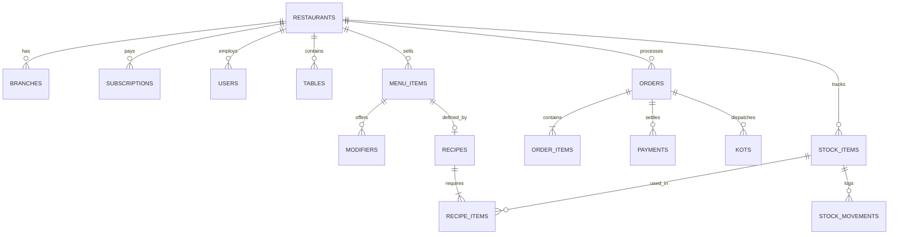

# Ralypto - Database Entities, Schema & Relations

This document defines the relational database architecture for Ralypto.

---

## 1. Core Principles

1. **Mandatory Multi-Tenant Isolation**: Every table (except platform-level tables `plans` and `super_admins`) must include `restaurant_id UUID NOT NULL REFERENCES restaurants(id)`. Every backend query must filter by `restaurant_id`.
2. **Financial Precision Rule**:
   - **Never use floating point numbers (`FLOAT`, `DOUBLE`) for currency.**
   - All monetary values are stored either as **64-bit integer cents** (e.g. `145000` for LKR 1,450.00) or `NUMERIC(14, 2)`.
   - Tax rates, percentages, and ingredient quantities use `NUMERIC(10, 4)`.
3. **Primary Keys & Timestamps**:
   - All primary keys use `UUID v4` (e.g. `gen_random_uuid()`).
   - Every table maintains `created_at TIMESTAMPTZ NOT NULL DEFAULT NOW()` and `updated_at TIMESTAMPTZ NOT NULL DEFAULT NOW()`.
   - Critical entities implement soft deletes via `deleted_at TIMESTAMPTZ NULL`.

---

## 2. Entity Catalog & Relationships

### Tenant & System Administration
- **`restaurants`**: The top-level tenant organization.
  - Fields: `id`, `name`, `code` (e.g. `CEY101`), `currency` (`LKR`), `tax_rate`, `service_charge_rate`, `logo_url`, `phone`, `email`, `address`, `status` (`active`, `past_due`, `suspended`), `created_at`, `updated_at`.
- **`branches`**: Physical outlet locations under a restaurant.
  - Fields: `id`, `restaurant_id`, `name`, `address`, `phone`, `is_main_branch`, `created_at`.
- **`plans`**: Subscription packages (`basic`, `standard`, `premium`).
  - Fields: `id`, `code`, `name`, `monthly_price_cents`, `max_users`, `max_branches`, `feature_flags` (`JSONB`), `is_active`.
- **`subscriptions`**: Active billing plan for a restaurant.
  - Fields: `id`, `restaurant_id`, `plan_id`, `status` (`active`, `grace_period`, `past_due`, `canceled`), `current_period_start`, `current_period_end`, `grace_period_end`.
- **`invoices`**: Monthly billing charges.
  - Fields: `id`, `restaurant_id`, `subscription_id`, `invoice_number`, `amount_cents`, `tax_cents`, `total_cents`, `status` (`paid`, `unpaid`, `overdue`), `due_date`, `paid_at`, `payment_method`.

### Users & Authentication
- **`roles`**: System roles (`super_admin`, `owner`, `manager`, `cashier`, `waiter`, `kitchen`, `accountant`).
  - Fields: `id`, `name`, `description`.
- **`users`**: Platform staff accounts.
  - Fields: `id`, `restaurant_id`, `branch_id`, `role_id`, `first_name`, `last_name`, `email` (nullable for waiters), `password_hash`, `pin_hash` (4-digit numeric PIN for quick terminal switch), `phone`, `is_active`, `last_login_at`.
- **`audit_logs`**: Immutable security logs for manager overrides and sensitive actions.
  - Fields: `id`, `restaurant_id`, `user_id`, `action`, `resource_type`, `resource_id`, `details` (`JSONB`), `ip_address`, `created_at`.

### Floor & Dining
- **`areas`**: Floor zones (e.g. `Ground Floor`, `Terrace`, `AC Dining`, `Rooftop Bar`).
  - Fields: `id`, `restaurant_id`, `branch_id`, `name`, `sort_order`.
- **`tables`**: Dining tables with seating capacity and live occupancy.
  - Fields: `id`, `restaurant_id`, `branch_id`, `area_id`, `number` (`"Table 5"`), `capacity`, `status` (`available`, `occupied`, `billed`, `reserved`, `cleaning`), `qr_code_hash`, `active_order_id`, `current_waiter_id`.

### Menu & Recipe Engineering
- **`categories`**: Menu classification (e.g. `Rice & Kottu`, `Appetizers`, `Beverages`).
  - Fields: `id`, `restaurant_id`, `name`, `icon`, `sort_order`, `is_active`, `target_station` (`kitchen`, `bar`).
- **`menu_items`**: Sellable food and beverage products.
  - Fields: `id`, `restaurant_id`, `category_id`, `name`, `description`, `price_cents`, `cost_cents`, `image_url`, `is_veg`, `is_spicy`, `is_available`, `sku`, `preparation_time_minutes`.
- **`modifiers`**: Customization options (e.g. `Spiciness Level: Mild, Medium, Extra Spicy`, `Portion: Regular, Large`).
  - Fields: `id`, `restaurant_id`, `menu_item_id`, `name`, `price_delta_cents`, `is_required`, `max_select`.
- **`recipes`**: Bill of Materials (BOM) linking a menu item to raw ingredients.
  - Fields: `id`, `restaurant_id`, `menu_item_id`, `yield_servings`, `instructions`.
- **`recipe_items`**: Ingredients and quantities required per recipe.
  - Fields: `id`, `recipe_id`, `stock_item_id`, `quantity_required`, `unit_of_measure`.

### Orders & Kitchen Display
- **`orders`**: Transaction orders across dine-in, takeaway, and delivery.
  - Fields: `id`, `restaurant_id`, `branch_id`, `order_number` (human-readable e.g. `ORD-2026-1004`), `table_id`, `customer_id`, `order_type` (`dine_in`, `takeaway`, `delivery`, `qr_self_order`), `status` (`draft`, `confirmed`, `preparing`, `ready`, `billed`, `completed`, `voided`), `waiter_id`, `cashier_id`, `subtotal_cents`, `discount_cents`, `discount_reason`, `tax_cents`, `service_charge_cents`, `total_cents`, `client_created_uuid`, `created_at`, `closed_at`.
- **`order_items`**: Individual dishes ordered.
  - Fields: `id`, `order_id`, `menu_item_id`, `quantity`, `unit_price_cents`, `subtotal_cents`, `notes`, `selected_modifiers` (`JSONB`), `status` (`pending`, `fired`, `preparing`, `ready`, `served`, `canceled`), `kot_id`.
- **`kots`**: Kitchen Order Tickets generated for cooking stations.
  - Fields: `id`, `restaurant_id`, `order_id`, `ticket_number` (`KOT-082`), `station` (`kitchen`, `bar`), `status` (`new`, `preparing`, `ready`, `collected`), `fired_at`, `completed_at`.

### Payments, Cashier Shifts & Cash Management
- **`shifts`**: Cashier register work shifts.
  - Fields: `id`, `restaurant_id`, `branch_id`, `user_id`, `opened_at`, `closed_at`, `opening_float_cents`, `closing_cash_cents`, `expected_cash_cents`, `cash_difference_cents`, `status` (`open`, `closed`), `notes`.
- **`cash_movements`**: Cash drawer ins and outs during a shift.
  - Fields: `id`, `shift_id`, `restaurant_id`, `movement_type` (`cash_in`, `cash_out`, `drop`), `amount_cents`, `reason`, `authorized_by_pin`, `created_at`.
- **`payments`**: Monetary settlement records.
  - Fields: `id`, `order_id`, `restaurant_id`, `shift_id`, `amount_cents`, `payment_method` (`cash`, `card`, `qr_code`, `online_transfer`), `status` (`completed`, `refunded`), `reference_number`, `created_at`.

### Inventory, Purchasing & Wastage
- **`stock_items`**: Raw food ingredients and packaging materials (e.g. `Basmati Rice`, `Chicken Breast`, `Lime`, `Cooking Oil`).
  - Fields: `id`, `restaurant_id`, `name`, `sku`, `unit` (`kg`, `liters`, `pieces`), `current_stock`, `reorder_threshold`, `average_cost_cents`, `is_active`.
- **`suppliers`**: Vendors and farmers.
  - Fields: `id`, `restaurant_id`, `company_name`, `contact_person`, `phone`, `email`, `address`.
- **`grns`**: Goods Received Notes (purchase orders received).
  - Fields: `id`, `restaurant_id`, `supplier_id`, `grn_number`, `invoice_reference`, `total_cost_cents`, `received_date`, `status` (`draft`, `received`, `verified`).
- **`stock_movements`**: Immutable inventory audit ledger.
  - Fields: `id`, `stock_item_id`, `restaurant_id`, `change_quantity`, `previous_stock`, `new_stock`, `movement_reason` (`grn_received`, `order_depletion`, `wastage`, `manual_audit`), `reference_id`, `created_at`.
- **`wastage`**: Spoiled, expired, or dropped food items.
  - Fields: `id`, `restaurant_id`, `stock_item_id`, `quantity_lost`, `unit`, `estimated_loss_cents`, `reason`, `logged_by_user_id`, `logged_at`.

### Back-Office: Accounting, HR & Delivery
- **`expenses`**: Operating expenses (e.g. utilities, rent, gas cylinders).
  - Fields: `id`, `restaurant_id`, `category` (`rent`, `electricity`, `gas`, `maintenance`, `marketing`), `amount_cents`, `payment_method`, `receipt_image_url`, `notes`, `incurred_date`.
- **`employees`**: Staff profiles for HR and payroll.
  - Fields: `id`, `restaurant_id`, `first_name`, `last_name`, `nic_passport`, `role_title`, `base_salary_cents`, `bank_account_info` (`JSONB`), `joined_date`.
- **`attendance`**: Daily clock-in and clock-out logs.
  - Fields: `id`, `employee_id`, `restaurant_id`, `clock_in_at`, `clock_out_at`, `total_hours_worked`, `overtime_hours`.
- **`payrolls`**: Monthly staff salary calculations.
  - Fields: `id`, `employee_id`, `restaurant_id`, `month_year` (`2026-10`), `base_pay_cents`, `overtime_cents`, `allowances_cents`, `deductions_cents`, `net_pay_cents`, `status` (`draft`, `approved`, `disbursed`).
- **`customers`**: Guest CRM profiles.
  - Fields: `id`, `restaurant_id`, `name`, `phone`, `email`, `total_orders_count`, `total_spend_cents`, `loyalty_points`.
- **`feedbacks`**: Guest ratings from QR digital receipts.
  - Fields: `id`, `restaurant_id`, `order_id`, `rating` (1–5), `comments`, `customer_phone`, `created_at`.
- **`delivery_orders`**: Aggregator deliveries (Uber Eats / PickMe).
  - Fields: `id`, `order_id`, `restaurant_id`, `platform` (`uber_eats`, `pickme`, `direct`), `external_order_id`, `driver_name`, `driver_phone`, `platform_commission_cents`, `delivery_status` (`dispatched`, `delivered`).

---

## 3. Entity Relationship Diagram (Summary)

